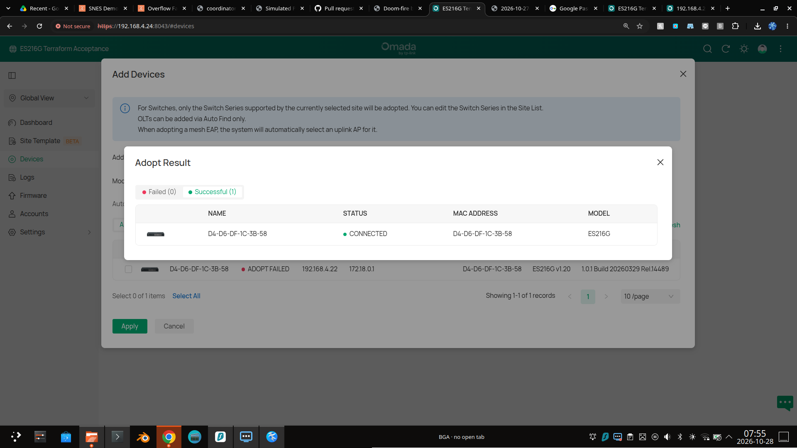

# ES216G Terraform acceptance: operator instructions

These instructions record the physical switch setup completed for the Terraform acceptance run. The [acceptance plan](../plans/es216g-terraform-acceptance.md) tracks remaining implementation and validation work.

## Controller and switch addresses

- Omada Software Controller: `https://192.168.4.24:8043`
- ES216G management address: `https://192.168.4.22`
- Switch MAC: `D4-D6-DF-1C-3B-58`
- Switch: ES216G hardware revision 1.20, firmware `1.0.1 Build 20260329 Rel.14489`

The controller uses a local self-signed certificate. Chrome may show a certificate warning when opening the controller console; use the local controller certificate exception/trust already established for this lab.

## Successful adoption

1. In the switch standalone UI, open **System → Controller Settings**.
2. Leave **Cloud-Based Controller Management** disabled and **Remote Adoption** enabled.
3. Set **Inform URL/IP Address** to `192.168.4.24`, then click **Apply**.
4. In the software controller, open **Devices → Add Devices** and select the ES216G.
5. If automatic adoption fails because the device credentials differ, retry with the username and password currently used to sign in to the switch at `https://192.168.4.22`.
6. Confirm the adoption result says **CONNECTED** and the MAC is `D4-D6-DF-1C-3B-58`.

### Credential distinction

`.es216g-lab/credentials.json` contains the controller administrator login and the controller site's generated device-management account. Those values are not necessarily the switch's current standalone login. The first adoption attempt using the generated device-account credentials failed; using the switch's current standalone credentials succeeded. Never put any of these passwords in documentation, Terraform files, or chat.

The CSV imported into Chrome Password Manager contains only the local controller administrator login. It does not contain the switch's standalone credentials.

## Current state and next steps

The ES216G is adopted and remains listed in the physical-test controller. During acceptance, port 8's name was changed temporarily and restored to `Port8`; controller readback confirmed that all writable port settings match the pre-test snapshot. No configuration backup was made, per the user's instruction. The controller remains running at `192.168.4.24:8043` for Terraform use.

Will confirmed ports 8–15 are physically empty and port 16 is the uplink. All seven Lenovo cables are connected; only one Lenovo was powered on during testing. The most recent controller read showed link up on ports 2, 4, and 16, so link state should not be used as a substitute for the physical cable map.

For future Terraform work:

1. Keep the controller running, or start it with `bash dev/es216g-lab/run.sh up` before provider operations.
2. Import the switch as `<site ID>/D4-D6-DF-1C-3B-58`.
3. When configuring `ports`, declare all 16 ports. The acceptance plan demonstrates preserving current writable fields.
4. Treat ports 8–15 as physically empty and port 16 as the uplink based on the current cable map; recheck after moving cables.

The temporary CSV imported into Chrome Password Manager was securely deleted after import.
