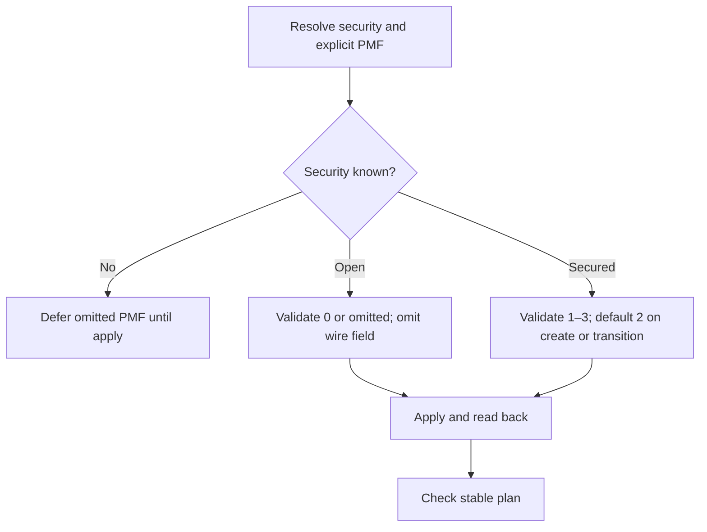

# L6 — Security-aware SSID PMF handling

Work for Will, 2026-10-19. Production branch `fix/ssid-pmf-handling` builds on L7 `ce80af6`. [Compatibility plan](../../plans/controller-compatibility.md).

## Verified controller contract

The pinned 6.1.0.19 UI's advanced SSID serializer omits `pmfMode` for open security. Its main asset exports PMF values **1 required, 2 capable/optional, 3 disabled**. The existing provider descriptions reversed 1 and 3; numeric values must not be silently remapped.

| Configuration | Planned value | Request |
| --- | --- | --- |
| Open, omitted PMF | 0 | Omit `pmfMode` |
| Open, explicit 0 | 0 | Omit `pmfMode` |
| Open, explicit nonzero | Diagnostic | No mutation |
| New secured SSID, omitted PMF | 2 | Send 2 |
| Open → secured, omitted PMF | 2 | Send 2 |
| Secured → open, omitted PMF | 0 | Omit PMF and PSK |
| Existing secured SSID, omitted PMF | Preserve | Retain controller value |
| Security unknown at plan | PMF remains unknown when omitted | Resolve and validate before creation |

```text
Review: security = 0, pmf_mode omitted
  Terraform plan: pmf_mode = 0
  API write: no pmfMode property
  Readback: pmf_mode = 0
  Next plan: no changes

Review: security = 0, pmf_mode = 2
  Diagnostic: open security requires pmf_mode = 0 or omission
  Action: correct configuration before applying
```



## Gates

- [x] Vendored Go vet/unit/build pass. All 26 mock and three live Terraform scenarios pass (21 live steps); WLAN client discovery passes.
- [x] Mock creation with default/explicit/unknown security and PMF; live run confirms the wire/readback contract.
- [x] Real nine-step PMF scenario passes open creation/rename/stable plan, open↔secured transitions, secured PMF 1/2/3, and unchanged identity.
- [x] Resource-level create/update tests verify explicit invalid values fail before API mutation; unknown-security values are deferred.
- [x] Update resource docs and retain reviewed evidence.
- [x] Remove disposable containers, owned networks/volumes, private runtime files, temporary UI extraction, and temporary patch. Cleanup exits zero.

## Lab setup finding

Repeated password rejection was not resolved by shortening the generated password. The bundled wizard validator requires a strong 10–64-character password and rejects adjacent identical characters; its helper compares each character with its neighbor. The rejected candidate had a repeated neighbor. The generator now guarantees strong character classes and excludes the preceding character when drawing each next character. Initialization succeeded with that generated value. No credentials are included in evidence.

## Compatibility

Existing explicit open-network PMF values 1–3 now require configuration correction (omit PMF or set 0). Secured numeric values retain their meaning; the corrected descriptions do not change stored numbers. Other controller versions and physical AP behavior remain unverified.

## First regression round

Open creation and its stable plan passed. Rename revealed that open responses can omit `pmfMode`, so the raw snapshot contract now requires it only for secured SSIDs. The first run's secured lifecycle/password/VLAN scenarios passed. Older mock expectations that treated PMF 2/3 as applicable to open security were corrected to model inapplicable mode 0; the updated creation tests include omitted PMF with unknown security. `acceptance-initial.log` retains the initial failures.

## Final result

`build.log` records the Go gates and compiled file hashes. `acceptance.log` contains 26 passing mock scenarios and three passing live scenarios. `client-probes.log` verifies WLAN discovery. Both suites and the shell wrapper exit zero (`test-status.txt`, `harness-status.txt`). `tested-followup.patch` is the exact combined L7/L6 overlay applied above D3; `source.sha256` identifies final worktree sources. Tests ran using Go 1.25.6, Terraform 1.15.8, vendored modules, and the isolated internal Docker network against controller 6.1.0.19.

The password generator was also sampled 100 times against the inspected length, character-class, and adjacent-repeat constraints; all samples passed. The controller accepted the generated initialization credential. Historical reports describing password length as the apparent cause are superseded by this verified adjacent-repeat finding.

L6 is locally verified and committed as `a046a36`; its lab changes are `c026124`. L7 was committed and pushed as `ce80af6`, lab changes as `1c4da91`, and documentation as `d543f6f` before starting L6. Remaining controller work is L2–L5; G2 recovery and physical-device validation are still pending.
