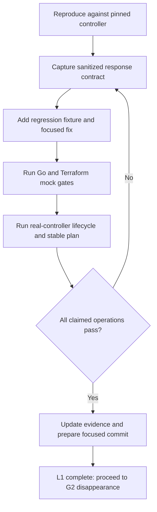

# Controller compatibility follow-ups

Prepared for Will on 2026-10-19 after running the real Software Controller 6.1.0.19. Parent: [reliability tracker](provider-reliability-prs.md). Evidence: [software-controller lab](../investigations/software-controller-lab/README.md). These labels supplement the historical F01–F16 report; they do not rewrite its baseline.

## Order and review boundaries

### L1 — WLAN groups are an unpaginated object envelope

- [x] Reproduce on G1: `/setting/wlans` returns the same `data` on pages 1 and 2, without pagination metadata. IDs are valid. G1 errors on the duplicate second page.
- [ ] Add an explicit per-endpoint collection policy for known unpaginated envelopes. Do not treat arbitrary missing totals, short pages, or repeated rows as proof of completion.
- [ ] Retain strict paginated behavior for networks, SSIDs, profiles, and other verified paged collections. Test populated variants where only empty responses have been observed.
- [ ] Add a fixture from the sanitized real shape, verify default/custom group lookup, and rerun D's SSID create/update/import/replacement scenarios on the controller.
- [ ] Rerun G1's malformed-page/failure gates and the real 102-network test. Commit a focused G1 follow-up before G2 can rely on collection completeness.

### L2 — Certificate wire format differs from the mocks

- [x] Reproduce upload rejection `-30021` using the provider's multipart `data={}`.
- [x] Verify that UI-style `cerName` / `keyName` metadata succeeds and returns `cerId` / `keyId`, with no generic `id`.
- [ ] Correct metadata and decode endpoint-specific identities; reject successful envelopes with missing/empty IDs.
- [ ] Verify activation fields, readback, restart requirements, and actual TLS presentation. An accepted upload alone is insufficient.
- [ ] Retain A's deadlock/retry/concurrency protections and F's status/body protections; rerun their gates plus real certificate lifecycle.

### L3 — Lost-session recovery

- [x] Invalidate the client's local cookie/token and observe HTTP 302 on the protected request; the client returns an HTTP error rather than reauthenticating.
- [ ] Capture the redirect's exact same-origin target and compare lost-cookie, invalid-CSRF-token, logout, and naturally expired-session responses.
- [ ] Specify a narrow reauthentication signal for supported controllers. Keep arbitrary/cross-origin redirects rejected, bound retries, and never send credentials or tokens to redirect destinations.
- [ ] Test failure state, concurrent requests, and multipart replay. Verify against the real controller; this probe did not wait for natural session expiry.

### L4 — IP-group endpoint mismatch

- [x] Observe provider route `/setting/firewall/ipGroups` rejected with `-1600`.
- [x] Locate `/setting/profiles/groups` and `/setting/profiles/groups/0` in the bundled UI and verify successful real responses.
- [ ] Inventory group types, identities, payloads, protected defaults, and pagination semantics before choosing a replacement route.
- [ ] Test complete IP-group CRUD/import and ACL references; retain compatibility declarations per supported controller version.

### L5 — Empty device inventory becomes Terraform null

- [x] Observe the real devices endpoint returning `[]` and successful client decoding to zero devices.
- [x] Locate the uninitialized nil slice in the data source and the failing existing acceptance assertion.
- [ ] Initialize empty collections consistently and test `length(data.omada_devices.example.devices) == 0` on a controller without devices.
- [ ] Audit other collection data sources for the same nil-to-null behavior; retain populated-list coverage.

## Review screens and flow

Concrete terminal review states for the next implementation round:

```text
$ dev/controller-lab/run.sh up
Controller: 6.1.0.19       Target: https://127.0.0.1:18043
Account: local lab        Adopted devices: 0
Archive: verified        Application JARs: 533 matched

$ dev/controller-lab/run.sh test
Go vet / unit / build: PASS
Terraform: 9 PASS, 3 FAIL
Open: WLAN discovery; empty-device assertion; length(null)
Action: fix L1 first; retain failures as regression evidence
```

```text
L1 review after the proposed correction
  WLAN group discovery      PASS: one complete unpaginated response
  SSID lifecycle            must pass on the real controller
  Network inventory         PASS required: 102 rows; last ID found
  Repeated paged identities  ERROR required: no partial success

Review action: inspect diff + logs, then prepare the focused commit
Next action: G2 only after complete discovery is verified
```

| Check | Current review result | Required result |
| --- | --- | --- |
| WLAN data-source plan | Duplicate identity error on repeated page 2 | Read complete known-unpaginated group list, then list SSIDs |
| Certificate apply | Upload rejected before activation | Nonempty certificate/key IDs; verified activation and TLS presentation |
| Refresh after lost session | HTTP 302 diagnostic | One bounded, verified reauthentication attempt or an explicit unsupported result |
| IP-group plan | API `-1600` | Correct typed group inventory from a verified route |
| Empty device count | Null list in Terraform | Empty list, count zero |



## Publication gates

- [ ] Keep each compatibility correction separately reviewable; the lab/vendoring branch records failures and contains no production correction for L1–L5.
- [ ] Recheck upstream heads and contribution requirements before opening PRs.
- [ ] Declare exact controller/version/test coverage. Physical AP/switch behavior remains unverified.
- [ ] Publish upstream only when authorized; fork commits and pushes are already authorized for this work.
