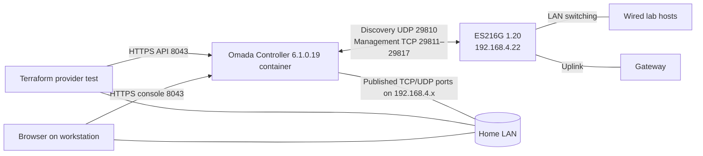
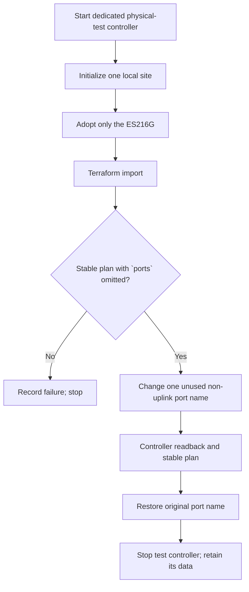

# ES216G Terraform acceptance plan

**Goal:** verify that this exact ES216G can be adopted by Omada Software Controller and managed through this Terraform provider. This physical acceptance run is in progress. The controller time zone and switch management mode/inform target have been changed as part of setup. No deliberate port-setting changes have been made; adoption side effects remain to be reconciled against the pre-adoption inventory. No configuration backup was made, per Will's instruction.

## Execution status — 2026-10-28

- The dedicated Omada Software Controller 6.1.0.19 container is running at `192.168.4.24:8043`; cloud binding is disabled.
- The switch's standalone **System → Controller Settings** page was used to set **Inform URL/IP Address** to `192.168.4.24`; **Cloud-Based Controller Management** remained disabled and **Remote Adoption** enabled.
- Adoption first failed because the controller-generated site device-account credentials in `.es216g-lab/credentials.json` were not the switch's current standalone login. Retrying with the credentials used to sign in to `https://192.168.4.22` succeeded.
- The controller UI reports the ES216G as **CONNECTED**. The provider lab's device-list query reports MAC `D4-D6-DF-1C-3B-58`, model ES216G, firmware `1.0.1 Build 20260329 Rel.14489`, status `11`.
- The success screen is preserved in the [ES216G operator instructions](../instructions/es216g-lab.md#successful-adoption).
- The provider's F15 worktree (`fix/switch-omitted-ports-plan`, commit `286a9a2`) imported the switch successfully using `<site ID>/<MAC>`. Two consecutive refresh/plans with `ports` omitted reported **No changes**. Terraform state and the temporary fixture are under `/tmp/es216g-terraform-acceptance`, outside the repository.
- Terraform's omitted-`ports` acceptance passed. Port map reconciliation and the reversible port-name test remain pending.

## Decision

Use a dedicated Docker Compose project for the physical-device run. Reuse the already verified, digest-pinned Omada Controller 6.1.0.19 community image from the controller lab. Docker here is rootless, so its `host` network is not the workstation's LAN network namespace and cannot receive the switch's discovery broadcast. Use bridge networking with controller ports published only on the workstation's current LAN address; set the switch's standalone Controller Inform URL to that address before adoption. Keep the existing isolated controller lab unchanged: it uses an internal-only bridge and loopback console, so it cannot discover or adopt physical devices.

The image is community packaging of TP-Link's controller, not an official TP-Link container. The controller JARs in the pinned image were compared with TP-Link's official 6.1.0.19 archive in the existing lab evidence. A supported Ubuntu 24.04 VM is the fallback if the container's LAN discovery or host-network behavior fails; the host itself runs Ubuntu 26.04, which TP-Link does not list for the 6.1.0.19 Linux package.

## Device and controller facts

- Switch: TP-Link Omada ES216G, hardware revision 1.20, firmware 1.0.1 Build 20260329 Rel.14489, management IP `192.168.4.22`.
- Current mode: adopted by the physical-test Omada Controller 6.1.0.19 and reported **CONNECTED**. Before this run it was managed through its standalone web UI.
- TP-Link documents both standalone and controller modes for the ES216G. Its firmware notes recommend Omada Controller 6.1.0 and say adoption retains some standalone settings, such as the management IP and management VLAN. The installation guide still says to reconfigure the switch when changing modes; do not assume all standalone port settings will carry across.
- Provider target: Omada Software Controller 6.1.0.19, matching the controller version used by the verified provider lab and the switch firmware recommendation.
- Terraform import ID: `<site ID>/<switch MAC>`.
- The switch is carrying the wired lab and its uplink. Identify the uplink and choose an unused, non-uplink test port before any write test.

## Lab automation

The separate `dev/es216g-lab/` harness is in place; the existing `dev/controller-lab/` isolated acceptance harness remains untouched.

- `compose.yaml`: the existing controller image pinned by the recorded digest; bridge networking with explicit LAN-IP-only port mappings; separate labeled persistent data/log volumes; bounded CPU/RAM; no cloud binding.
- `run.sh`: `up`, `status`, `devices`, `environment`, `credentials-csv`, `shred-credentials-csv`, and `down` commands. `down` stops this controller only and preserves its data volume. Automated `preflight` and Terraform `test` commands are not implemented yet.
- Private runtime directory: ignored by Git and mode `0700`; generated controller credentials stored in a mode `0600` env file, never in command arguments or logs.
- Network preflight: confirm the host has a `192.168.4.x` address, can reach `192.168.4.22`, and has no conflicting controller ports. Limit controller UI and device ports to that LAN address. Do not add WAN port forwarding.
- Required device traffic: UDP 29810 for discovery and TCP 29811–29817 for controller management/adoption, as required by the controller version/device firmware. TCP 8043 is the local HTTPS console and provider API. Restrict these to the home LAN; do not broadly expose them.
- Initialization: one local controller account and one test site were created; cloud binding is disabled. The private runtime file contains controller credentials and the controller's site device-account credentials. Those generated site credentials are not the existing standalone login that the switch required during adoption.
- Terraform fixture: use a temporary directory and environment variables for controller URL/account. Never write credentials into the repository or Terraform files.

The existing verified controller image reference is `mbentley/omada-controller:6.1.0.19@sha256:94571a6544a5db9419681d3cecdaa7dccf9042e586cae9a1c34c3f22994e6b38`. Its source and verification are recorded in [the controller lab plan](software-controller-lab.md) and [lab evidence](../investigations/software-controller-lab/README.md).

## Test topology

## Execution sequence

### 1. Build the isolated physical-test controller

- [x] Add the dedicated Compose project and runner described above.
- [ ] Validate that `up`, `status`, and `down` touch only resources carrying the new project's ownership label.
- [x] Start the controller without cloud binding and confirm its console at `https://192.168.4.24:8043`.
- [x] Bind published controller ports to the workstation's LAN address. A separate port-reachability/security scan remains unverified.
- [x] Confirm the host can ping the switch and that the switch and controller are on the same subnet.
- [x] In the switch's standalone Controller Settings, set its Inform URL/IP Address to `192.168.4.24`; this replaces broadcast discovery that rootless Docker cannot receive.

### 2. Adopt the ES216G

- [x] Capture read-only device identity from the controller: MAC, model/revision, and firmware. The controller reports 16 configured ports named `Port1` through `Port16`, all enabled with profile `All`.
- [x] Capture current controller link state: ports 3, 7, and 16 report link up; ports 1–2, 4–6, and 8–15 report link down. Port 3 reports link-speed code 1; ports 7 and 16 report code 3. Port 5 is down but has nonzero historical counters.
- [ ] Reconcile the controller view against a pre-adoption standalone inventory and physical cable map. Home-lab notes say the seven Lenovo links are connected but do not map them to switch ports; a link-down state alone does not prove that a port has no cable.
- [ ] Confirm the test port is unused/non-uplink; do not guess based on the port number.
- [x] Create the test site and adopt only the discovered ES216G. The first attempt with controller-generated site device-account credentials failed; retrying with the switch's current standalone UI credentials succeeded.
- [x] Confirm the controller reports the ES216G as connected. Record the MAC, model, and firmware above.
- [ ] Capture and reconcile the controller's port view against the standalone port inventory before Terraform writes; identify the uplink and an unused test port.

### 3. Verify Terraform read/import behavior

- [x] Configure the F15 worktree provider against the controller's LAN address and create a temporary resource block for the ES216G.
- [x] Import using `<site ID>/<MAC>`.
- [x] Omit the whole `ports` attribute and require a stable, empty second plan. Two consecutive plans were empty on the real controller/device path, with no port configuration changes.
- [x] Refresh preserved the controller-reported device identity and configured port state.

### 4. Verify a reversible port update

- [ ] Configure every port in the list if `ports` is set; mark all values from the controller inventory explicitly so omitted fields remain under test.
- [ ] Select one verified-unused, non-uplink port and change only its display name. Apply, read it back through the controller, refresh Terraform, and require a stable next plan.
- [ ] Restore the original name; apply and verify readback and a stable plan.
- [ ] If display-name writes are unsupported on this exact controller/device combination, stop and record the response. Do not substitute a VLAN/PVID change without reviewing the port's physical use and connectivity impact.
- [ ] Verify `terraform destroy` removes only the Terraform state entry; it must not delete or unadopt the physical switch.

### 5. Record and stop

- [ ] Record controller version, switch model/revision/firmware, import result, plan results, request outcome, and the selected test-port number. Sanitize logs and exclude credentials.
- [ ] Keep the physical controller profile separate from existing mock/controller acceptance results.
- [ ] Stop the test controller while retaining its data volume. Leave the switch adopted so the controller/provider path remains available for follow-up.
- [ ] Update the reliability tracker only after the live results pass; otherwise record the precise failing operation and retain the hardware-compatibility item as open.

## Safety and limits

Terraform validation should remain read-only through import and repeated planning. Adoption has already changed the switch's management mode; inspect and reconcile the resulting port settings before making any port write. Avoid the uplink and ports in use by the seven wired lab hosts. Do not change VLAN membership, PVID, port profile, or link state in this acceptance run.

This plan intentionally omits a configuration-backup step at Will's request. If adoption appears to have changed port configuration, record the observed state and stop before further changes until its effect is understood.

Passing this sequence establishes compatibility only for ES216G hardware revision 1.20, firmware 1.0.1 Build 20260329, and Omada Controller 6.1.0.19. It does not establish support for other hardware revisions, firmware versions, or controller releases.

## References

- [TP-Link ES216G V1.20 firmware 1.0.1 release notes](https://static.tp-link.com/upload/firmware/2026/202604/20260428/ES216G%28UN%29_V1.20_1.0.1_Release%20Note.pdf)
- [TP-Link ES216G installation guide](https://static.tp-link.com/upload/manual/2024/202410/20241022/7106511600_ES220GMP%2CES228GMP%2CES216G%2CES224G%28UN%29_IG.pdf)
- [Omada Software Controller downloads](https://support.omadanetworks.com/en/download/software/omada-controller/)
- [Omada Software Controller Linux installation guide](https://support.omadanetworks.com/en/document/13088/)
- [Omada device discovery and adoption ports](https://support.omadanetworks.com/cac/document/13223/)
