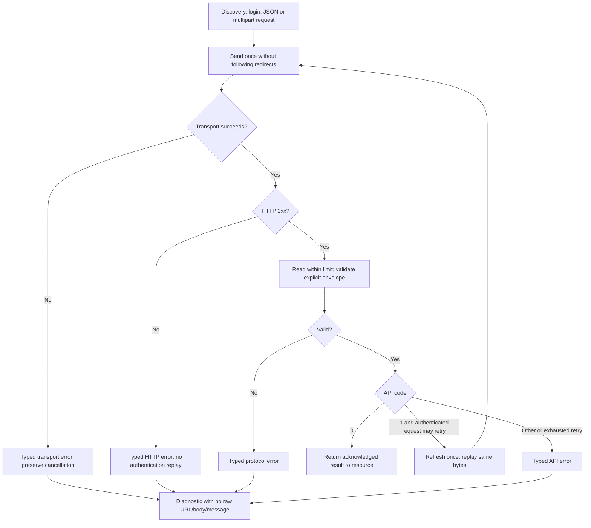

# F — HTTP response validation

Prepared for Will on 2026-10-19. Implemented and locally verified and pushed as [c210dec](https://github.com/wbniv/terraform-provider-tplink-omada/commit/c210dec9a4bb10a15881f15a250b7c1843543d31), on `fix/http-responses` in `/home/will/terraform-provider-tplink-omada-http-responses`, based on E `8f24c37c643a968e51cc77aeb63d3ffe2f0a96e5` (including A). Parent: [reliability tracker](provider-reliability-prs.md#f--response-handling). Original finding: [F12](../investigations/2026-10-18-code-review.md#f12--http-errors-can-be-accepted-as-success).

## Decisions and scope

- [x] Inspect the shared authenticated helper, login, discovery, existing authentication tests, and downstream credential recovery tests. All three request paths need the same validation.
- [x] Stack on E so its maintained acceptance assertions can follow deliberate diagnostic changes. Preserve A's bounded retry/concurrency behavior and E's acknowledged-write state handling.
- [x] Require HTTP 2xx and one valid JSON object with an explicit, non-null integer `errorCode`. Reject missing/invalid/duplicate envelope fields, trailing data, malformed JSON, and oversized responses.
- [x] Keep an explicit success envelope with an absent/null/empty `result` valid for write endpoints. Reject an entirely empty body, including HTTP 204, until a specific endpoint's empty-body contract is documented; there is no such exception in current repository evidence.
- [x] Reject redirects without replaying login credentials, session headers, or mutation requests to another URL. Configure the controller's final API URL directly.
- [x] Return typed HTTP, API, protocol, and transport errors. Preserve cancellation through error unwrapping. HTTP 404 is an HTTP error, not proof of object absence; resource disappearance and API not-found mappings remain G/F10 after complete discovery.
- [x] Retry only an explicit `errorCode=-1` in a valid HTTP 2xx envelope, once. A 401/403/5xx response, even containing `-1`, must not trigger an authentication/mutation replay.
- [x] Bound successful response reads to 16 MiB. Diagnostic text uses fixed reasons and numeric status/code; omit arbitrary server messages, bodies, headers, and URLs so echoed credentials cannot escape via these errors. Retain transport causes for `errors.Is`/`errors.As` without printing their raw text.
- [x] Replace Agile Series string matching with a typed `-39742` API error check; reject lookalike text or failed HTTP responses as route-switch triggers.
- [x] Test Terraform destroy failure/retry: failed DELETE keeps the real object and state; a later acknowledged DELETE removes both. Do not add missing-object removal in F.

## Concrete review screens

| Terraform action | Response and visible diagnostic | Expected state / next action |
| --- | --- | --- |
| Destroy `omada_network.test` | HTTP 403 with `{"message":"Forbidden"}` → `HTTP error 403` | Apply fails; network remains in state; repair authorization and retry |
| Destroy retry | HTTP 200 with `{"errorCode":0}` | DELETE acknowledged; resource removed from state |
| Update credentials | HTTP 502 with an apparent success envelope → `HTTP error 502` | No success reported; retain prior state; verify controller before retrying |
| Valid session expires | HTTP 200, code -1 → one login and one replay | Matching refreshed header/query tokens; repeated expiry errors |
| Controller URL redirects | HTTP 302 → `HTTP error 302` | No redirected request; configure the final API URL |
| Controller sends invalid/oversized JSON | Fixed protocol error without raw response | Operation fails; inspect controller/proxy logs without exposing response bodies in Terraform output |

## Verification and agenda

### 2026-10-19 — Implementation

- [x] Recheck upstream main (`6bc71b3`) and contribution requirements; no explicit AI-attribution requirement found. Use verified metadata if one becomes applicable.
- [x] Create isolated worktree on E; retain existing code/doc branches.
- [x] Promote F12 reproduction into maintained behavior tests, run the same tests on E baseline and F, and save both logs.
- [x] Cover JSON/text/HTML HTTP failures, apparent-success errors, missing/null/string/fractional/duplicate codes, null/array/empty/truncated/trailing JSON, response-size boundary, discovery/login, redirects, multipart, cancellation, failed reads, and redaction.
- [x] Verify typed errors and no false Agile fallback; retain valid API fallback, read-only protection, session retries, concurrent refresh, and cancellation tests.
- [x] Run Terraform destroy/retry scenarios with a local mock controller; keep state after rejected deletes and check successful recovery.
- [x] Run Go 1.25.6 formatting/vet/build/full tests and targeted race tests in pinned Docker; Terraform 1.15.8 runs inside the container.
- [x] Run all E credential scenarios and combined D1–D3 acceptance. If older test assertions require arbitrary server messages, retain an explicit compatibility-test adjustment rather than weakening redaction or silently claiming unchanged tests passed.
- [x] Finish evidence/tracker updates, final link/hash checks, and cleanup. All nine source hashes match the tested container; prior code worktrees remain clean. The disposable container and host archives/patches are removed.

### Conditional — Submission and controller validation

- [x] Commit/push F as [c210dec](https://github.com/wbniv/terraform-provider-tplink-omada/commit/c210dec9a4bb10a15881f15a250b7c1843543d31); all nine committed hashes match the tested sources and the fork ref is verified.
- [ ] Verify accepted envelopes, actual expiry status/codes, reverse-proxy behavior, response sizes, and empty responses on a controlled controller. Mock tests do not establish firmware compatibility.
- [ ] Recheck upstream and contribution/attribution rules before publication; record PR/CI/review/merge separately.

## Sources and limits

Go's [HTTP client contract](https://pkg.go.dev/net/http#Client.Do) requires callers to inspect HTTP status and defines redirect handling. Its [errors package](https://pkg.go.dev/errors) supplies typed/wrapped error inspection. HashiCorp's [Delete contract](https://developer.hashicorp.com/terraform/plugin/framework/resources/delete) keeps resources in state when deletion returns an error. Tests must verify the provider integration as well as the client result.

No general API not-found code mapping or empty-body success contract has been established from controller evidence. Later G must distinguish complete confirmed absence from HTTP, authorization, transport, and partial-list failures. A failed/invalid response can follow a controller mutation that actually occurred; F rejects an untrustworthy acknowledgment but cannot roll back or infer that remote outcome. General resource-specific decoding and multi-operation recovery remain separate work.

## Verification progress

- [x] Same 214 client behavior cases: E baseline has 149 failures and 65 passes; F passes all 214. Nine additional typed-error/read-limit cases pass.
- [x] All five Terraform delete/retry scenarios fail on E baseline; local F run passes, alongside all 12 E scenarios. The final combined run also verifies the final harness and D1–D3 integration.
- [x] Formatting/vet/build/full unit and full client race checks pass in Docker.
- [x] Complete combined 41-scenario/205-step verification with the explicit six-assertion SSID diagnostic compatibility patch; see [F evidence](../investigations/http-response-fix/README.md).

G1 complete pagination is now locally verified and pushed as [9343503](https://github.com/wbniv/terraform-provider-tplink-omada/commit/9343503d13a5428e91d121e0104ce7c36cd93cd6); see the [G1/G2 plan](pagination-and-disappearance.md). Next is software-controller validation, then G2 confirmed disappearance (F10). F is committed and pushed as [c210dec](https://github.com/wbniv/terraform-provider-tplink-omada/commit/c210dec9a4bb10a15881f15a250b7c1843543d31); controller validation and upstream gates remain open. The six-assertion SSID test adjustment must accompany integration of D1–D3 with F.
