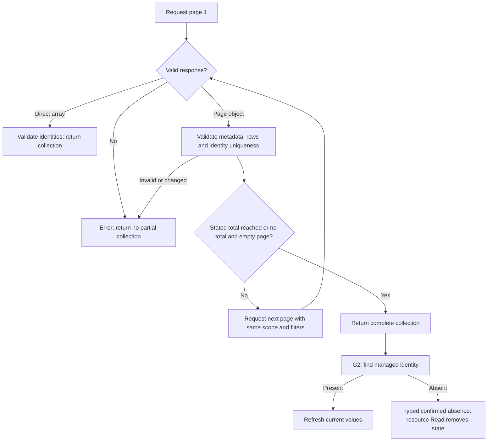

# G — Complete pagination and confirmed disappearance

Prepared for Will on 2026-10-19. Parent: [reliability tracker](provider-reliability-prs.md). Findings: F09 and F10 in the [baseline investigation](../investigations/2026-10-18-code-review.md). F is committed/pushed as `c210dec`; G1 starts on that commit in `/home/will/terraform-provider-tplink-omada-pagination`, branch `fix/complete-pagination`.

## Review boundaries

- [x] **G1 / F09: complete collection reads.** Iterate pages in every affected list method and raw SSID lookup. Verify the entire response before returning anything to callers. Keep the public resource schemas and existing absence behavior unchanged.
- [ ] **G2 / F10: confirmed disappearance.** Build on verified G1. Add a semantic absence type for successful complete lookups, audit Read/Delete paths, and remove state only with positive evidence of absence. Direct endpoint HTTP 404, permission errors, incomplete lists, and decoding failures must retain state.

Splitting G avoids coupling pagination changes to automatic Terraform state removal. G1 is implemented and locally verified, pushed as [9343503](https://github.com/wbniv/terraform-provider-tplink-omada/commit/9343503d13a5428e91d121e0104ce7c36cd93cd6). G2 follows in a separate patch. The [software-controller lab](software-controller-lab.md) now supplies real API evidence, including 102 networks. It found a G1 regression for unpaginated WLAN-group envelopes; [L1](controller-compatibility.md) must precede G2. Mocks remain necessary for injected failures.

## G1 collection inventory and policy

| Collection | Scope / API route | Additional requirement |
| --- | --- | --- |
| Sites | Global `/sites` | Site name/ID resolution must reach later pages |
| Networks | Site `/setting/lan/networks` | Resource lookup and network data source |
| WLAN groups | Site `/setting/wlans` | Group lookup and default selection keep existing semantics |
| SSIDs | Site/group `/setting/wlans/{id}/ssids` | Typed list and raw PATCH lookup both complete; preserve unknown JSON fields |
| Port profiles | Site `/setting/lan/profiles` | Lookup and data source |
| ACL rules | Site `/setting/firewall/acls` | Preserve `type` filter on every request |
| IP groups | Site `/setting/firewall/ipGroups` | Lookup and data source |
| mDNS rules | Site `/setting/service/mdns` | Accept pagination metadata alongside capability fields |
| SAML IdPs | Global `/idps` | Identity is `idpId` in the wire response; name/create readback inherits complete listing |
| SAML roles | Global `/extendUserGroups` | Lookup and create readback inherit complete listing |
| Devices | Site `/devices` | Existing direct-array endpoint; verify unchanged behavior, do not invent paging support |

- [x] Request pages beginning at 1 with size 100, preserving route/filter parameters and refreshed authentication tokens.
- [x] Accept a direct array as the complete unpaginated response on the first request. Reject a change from paginated objects to direct arrays midway.
- [x] For object responses, require an array `data`. Validate present metadata; distinguish absent fields from zero/null. Use stable `totalRows` when supplied; otherwise request until an empty page. Never infer completion merely from a short page because the server may cap page size.
- [x] Fail with no partial results for later-page errors, early empty pages before a stated total, changed totals, mismatched page numbers, duplicate identities, malformed rows/metadata, and excessive page count or cumulative response size (10,000 pages / 64 MiB of result JSON). Preserve cancellation and F's safe diagnostics.
- [x] Keep result order and raw SSID attributes. A list with concurrent mutations can fail and be retried; no snapshot guarantee is possible without controller support.
- [x] Correct existing synthetic fixture counts if strict validation exposes inconsistent totals; document these fixture changes explicitly.

## Concrete Terraform review screens

| Screen / action | Expected visible result | Subsequent action |
| --- | --- | --- |
| `terraform plan` importing network 101 | Existing network recognized; import plan uses its actual configuration | Apply import, then verify an empty plan |
| Network data source with 201 entries | All 201 entries, including the last page | Verify ordered IDs and count |
| Refresh: page 2 returns HTTP 503 | Error with HTTP status; managed network identity remains in state | Restore controller and retry refresh |
| Refresh: pagination repeats an identity | Fixed invalid-response diagnostic; no partial success | Retry after controller consistency is restored |
| G2 refresh: complete inventory excludes managed ID | Refresh records disappearance; normal plan proposes creation | Review and apply recreation, then verify stable state |
| G2 refresh: authorization fails or route returns 404 | Diagnostic; no automatic state removal | Correct authorization/route and retry |

## Agenda and gates

### 2026-10-19 — G1 implementation

- [x] Create isolated worktree based on F; inventory all fixed-page calls and direct-array devices.
- [x] Recheck contribution requirements: conventional commits, format/vet/tests, documentation, real-controller declaration. No explicit AI attribution rule found.
- [x] Write maintained regressions and run the same behavioral tests against F baseline and G1.
- [x] Cover all ten collections plus raw SSID lookup, direct arrays, more than 100 rows, empty collections, capped pages, omitted metadata, changed totals, invalid rows, repeated pages, cancellation, and errors after a partial read.
- [x] Add Terraform import/data-source/failed-refresh recovery evidence with the managed object beyond page 1.
- [x] Run Go 1.25.6 fmt/vet/build/full unit/race and Terraform 1.15.8 tests in Docker. Save exact commands, logs, counts, and hashes under `docs/investigations/pagination-fix/`.
- [x] Check D1–D3 integration, including the existing F diagnostic assertion patch; preserve other worktrees.
- [x] Update this plan, tracker, and investigation; remove disposable test services and files.

### Next — G2 implementation

- [ ] Audit all 14 resource types: sites/settings, networks, WLAN groups, SSIDs, port profiles, APs/switches, ACLs, IP groups, mDNS, SAML IdPs/roles, and certificates.
- [ ] Use typed confirmed absence only after complete, successful discovery. Specify evidence for direct endpoints and parent disappearance; keep unsupported mappings as explicit open gates.
- [ ] Add Read tests for removal on absence and state retention for transport/auth/protocol/partial-list failures.
- [ ] Define and test already-absent Delete behavior without hiding rejection of an existing object; preserve protected/default-resource semantics.
- [ ] Run Terraform out-of-band deletion, refresh/recreation, retry, and repeated empty-plan scenarios; check import and data sources still report missing objects appropriately.

### Conditional — Controller validation and submission

- [x] Validate initial page metadata and collection behavior on Software Controller 6.1.0.19, including 102 real networks; record zero-device limitations.
- [ ] Repair the unpaginated WLAN-group envelope regression before claiming compatibility. Populated variants of the other empty collections remain unverified.
- [ ] Commit/push each patch when requested; verify file hashes and remote refs.
- [ ] Recheck upstream/standards, prepare separate PR descriptions, and publish only when authorized. Record CI/review/merge separately.

No G tests have run and no G production code has changed at the time this plan was first written. Subsequent progress belongs below.

## Progress

- [x] G1 is implemented and locally verified, pushed as [9343503](https://github.com/wbniv/terraform-provider-tplink-omada/commit/9343503d13a5428e91d121e0104ce7c36cd93cd6). All 94 client cases, full Go/race gates, three new Terraform scenarios/11 steps, and combined 44 scenarios/216 steps pass. [Evidence and integration notes](../investigations/pagination-fix/README.md).
- [ ] G2 not started.

Next: correct the measured WLAN-group pagination contract under [L1](controller-compatibility.md), rerun the real-controller suite, then implement G2 confirmed disappearance. Preserve the recorded D integration and fixture patches; original D worktrees remain unchanged.
