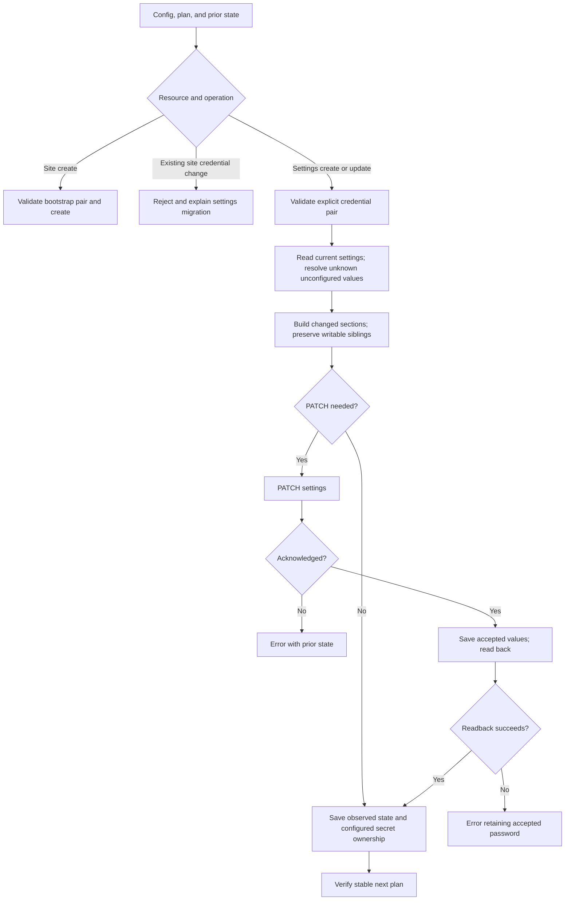

# E — Site device credentials

Prepared for Will on 2026-10-19. Implemented, locally verified, committed, and pushed as [8f24c37](https://github.com/wbniv/terraform-provider-tplink-omada/commit/8f24c37c643a968e51cc77aeb63d3ffe2f0a96e5) in `/home/will/terraform-provider-tplink-omada-credentials`, branch `fix/site-credentials`, based on authentication A `52ed681674e5a0058ae7807fcd08399c21fa021a`. Parent: [reliability tracker](provider-reliability-prs.md#e--credentials).

## Contract and scope

- [x] Inspect F05/F06, the site/settings lifecycle, request models, and retained probes.
- [x] Choose one rotation owner: `omada_site_settings`. Site fields remain bootstrap inputs; changed existing-site credentials must fail explicitly, without replacing the site or claiming an unapplied rotation.
- [x] Validate bootstrap inputs before site creation. Permit removing both site credential inputs without changing remote credentials, and document migration to settings.
- [x] Require both username and password explicitly configured to manage settings credentials. Username-only/password-only *changes* work with the unchanged counterpart configured; a partially configured pair must fail before mutation.
- [x] Never import/refresh API passwords or masks into managed secret state. A configured successful rotation keeps the new planned password. Omission of both settings credential inputs relinquishes control without changing remote credentials and removes the optional password from state after apply.
- [x] Reject unresolved/empty credential inputs before writing; defer unknown configured values during planning and test real Terraform resolution.
- [x] Preserve prior state on rejected PATCH/discovery failures. Separate acknowledged PATCH from readback so a successful rotation followed by GET failure retains the accepted new password with an error.
- [x] Keep credential-only PATCHes from changing unrelated settings: resolve unconfigured unknown values from a fresh snapshot and send only changed top-level sections. Preserve known writable siblings in a changed section; stop if unknown section fields would be lost. Keep existing schema defaults explicit; this does not redesign their ownership.
- [x] Record any new settings preservation findings with evidence; do not bury additional defects under F05/F06.

## Review screens and actions

| Terraform review screen | Choice / action | Verification |
| --- | --- | --- |
| Existing `omada_site`: changed device password | Error instructing migration to `omada_site_settings`; no replacement or PATCH | Old site identity/credentials retained |
| Remove both site credential inputs; configure both settings inputs | Review site state removal plus settings credential update | No site replacement; one settings credential PATCH |
| Settings password rotation | In-place update; password shown as sensitive | PATCH contains configured pair; state contains accepted new password; repeated plan empty |
| Settings username rotation | In-place update with unchanged configured password | Complete pair sent; observed username verified |
| Remove both settings credential inputs | Relinquish ownership; clear optional secret in state | No credential PATCH; remote credentials unchanged |
| PATCH accepted, readback fails | Error; accepted state retained | New password kept for recovery; next refresh/plan settles |

## Regression matrix and gates

- [x] Direct cases: site changed/removed/unknown credentials, missing bootstrap pair, settings password-only/username-only/combined changes, null/imported secrets, plaintext/multiple masks/absent API passwords, omitted/partial config, read/PATCH/readback failures, redacted diagnostics, unrelated settings preservation.
- [x] Actual Terraform: import, adopt, rotate, remove config, failed update/retry, unknown references, migration from site to settings, stable repeated plans, zero site replacement.
- [x] Record failures on A baseline with the same final tests and passes on E.
- [x] Docker Go 1.25.6 formatting, vet, build, full unit suite; Terraform 1.15.8 mock acceptance. Pin the existing Go image digest from earlier investigations.
- [x] Verify compatibility with the existing D1–D3 stack as appropriate; avoid changing its files.
- [x] Update resource docs, generation templates, examples, investigation, tracker, commands, hashes, versions, and results.
- [x] Recheck contribution/AI attribution requirements; conventional breaking-change notes where needed, verified metadata only if attribution is required.
- [x] Remove temporary containers/files after evidence is saved. Commit/push and upstream submission remain separate gates.
- [ ] Validate API payloads, username/password rules, device propagation, failure responses, and credentials on controlled hardware. Mock tests are not hardware proof.

## Sources and limits

[HashiCorp Update guidance](https://developer.hashicorp.com/terraform/plugin/framework/resources/update) requires state to represent applied values and known values after errors; [planning guidance](https://developer.hashicorp.com/terraform/plugin/framework/resources/plan-modification) explains unknown computed attributes. The existing client declares site settings a partial PATCH endpoint. Its device-account pair requirement and nested-section behavior remain repository/API assumptions until controller validation. The existing full settings serializer writes unknown values as zero values; credential-only tests must detect resulting unrelated mutations.

### 2026-10-19 — Implementation

- [x] Create the isolated E worktree on A; start the pinned Docker environment.
- [x] Reproduce and implement F05/F06 plus newly discovered F16 settings preservation. All 48 direct cases and 12 Terraform scenarios (65 steps) pass; baseline has 44 direct failures and all 12 scenarios fail.
- [x] Pass formatting/vet/build/full Go suite and example formatting in Docker Go 1.25.6 / Terraform 1.15.8.
- [x] Verify combined A + D1–D3 + E: full unit suite and 36 Terraform scenarios (185 steps) pass.
- [x] Record commands, logs, 15 matching tested source hashes, breaking behavior, and limitations in [E evidence](../investigations/site-credentials-fix/README.md); update the parent tracker and investigation.
- [x] Finish cleanup and final documentation checks.

### Conditional — Review and hardware

- [x] Commit/push E as [8f24c37](https://github.com/wbniv/terraform-provider-tplink-omada/commit/8f24c37c643a968e51cc77aeb63d3ffe2f0a96e5); verify all 15 committed hashes and the matching remote branch.
- [ ] Publish upstream PRs only when authorized.
- [ ] Complete controller checks when access is available.

## Current outcome and next work

E is locally complete and committed/pushed as [8f24c37](https://github.com/wbniv/terraform-provider-tplink-omada/commit/8f24c37c643a968e51cc77aeb63d3ffe2f0a96e5). Site credentials are bootstrap-only; settings owns rotation and requires both explicit inputs. API secrets never replace managed state. Accepted rotations retain the new password after failed readback. F16 is fixed by preserving unknown unrelated settings and patching changed sections. Existing noncredential defaults still apply; review the full import/adoption plan. Cross-resource uniqueness is documented rather than enforced.

F/F12 HTTP status/envelope validation is now locally verified on E and pushed as [c210dec](https://github.com/wbniv/terraform-provider-tplink-omada/commit/c210dec9a4bb10a15881f15a250b7c1843543d31); see the [F plan](http-responses.md). G1/F09 pagination is now locally verified and pushed as [9343503](https://github.com/wbniv/terraform-provider-tplink-omada/commit/9343503d13a5428e91d121e0104ce7c36cd93cd6); see the [G1/G2 plan](pagination-and-disappearance.md). Next is software-controller validation, then G2/F10 confirmed disappearance. Controller compatibility and upstream submission remain separate open gates.
