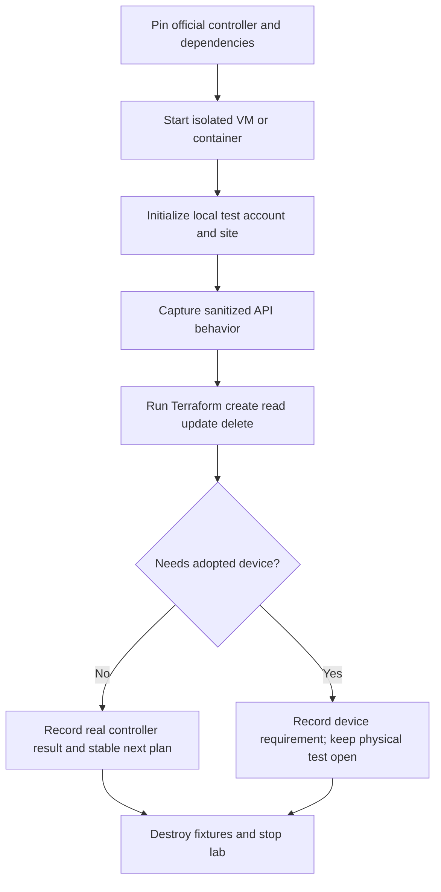

# Software-controller validation lab

Prepared for Will on 2026-10-19 after his question about virtual appliances. The real Omada Software Controller 6.1.0.19 is now running in the disposable lab; first results are recorded below. Parent: [reliability tracker](provider-reliability-prs.md).

## What is available

TP-Link distributes a free Omada Software Controller for Linux and Windows. A Linux VM can therefore host the real management application. The [official downloads](https://support.omadanetworks.com/en/download/software/omada-controller/) and [controller guide](https://support.omadanetworks.com/en/document/111217/) establish this deployment option. Linux containers may also be suitable after checking the selected version's Java, MongoDB, and service requirements; a community image must be identified as such, with its build source and digest recorded.

The previous blanket hardware-validation gate was too broad. Real controller API validation can begin without a hardware controller. Whether every configuration endpoint works with zero adopted devices must be established experimentally. Physical adoption, radio behavior, switch-port behavior, forwarding, and propagation of device credentials still require appropriate devices. TP-Link's [web emulator](https://www.tp-link.com/us/support/emulator/) demonstrates the interface; it does not establish availability of runnable device firmware or a device simulator. No official runnable switch/AP emulator was identified in this search.

The load balancer Will may have been remembering is [F5 BIG-IP Virtual Edition](https://www.f5.com/trials/big-ip-virtual-edition). That comparison motivated checking Omada's software deployment option.

## Concrete setup and review screens

| Stage | Screen / review information | Resulting action |
| --- | --- | --- |
| Select controller | Official package version, URL, checksum; VM or container dependencies | Pin an exact version matching the provider's documented target first; add newer versions separately |
| Create isolated lab | Fresh data directory, loopback management URL, synthetic local administrator; zero adopted devices | Start disposable controller; avoid production/cloud credentials and network discovery exposure |
| Initialize | Controller name, region/timezone, test site, local account; skip cloud binding and device adoption where supported | Record the setup procedure without credentials in evidence |
| Review Terraform | Local controller URL, fixture site and configuration resources; inspect plan | Run `terraform plan`, `terraform apply`, refresh, and destroy inside the existing test container |
| Inspect results | Controller version, request route/status, sanitized envelope shape, final state and next plan | Save reproducible evidence; distinguish API acceptance from physical device behavior |
| Finish | Managed test objects removed; saved evidence complete | Stop/remove disposable services and data; preserve reusable scripts and sanitized logs |

## Agenda

### 2026-10-19 — Research and scope correction

- [x] Verify official free software-controller availability and record sources.
- [x] Separate software-controller checks from physical-device checks in the reliability tracker.
- [x] Retain existing mock results as synthetic evidence; do not relabel them as controller tests.

### 2026-10-19 — First real-controller round

- [x] Inspect the version target: README specifies Software Controller 6.x; maintained client fixtures report 6.1.0.19. Use 6.1.0.19 for the first lab. TP-Link lists official Linux packages for this version.
- [x] Pin the `mbentley/omada-controller:6.1.0.19` community image by digest; verify all 533 application JARs against TP-Link's official archive. Runtime: Java 17.0.20.1 and MongoDB 8.0.32.
- [x] Add repeatable isolated startup, initialization, test, and cleanup scripts; record resource/port limits.
- [x] Exercise discovery, local login, JSON/status envelopes, lost-local-session recovery, and certificate uploads. Preserve actual failures; naturally expired sessions and working activation remain open.
- [x] Exercise network/profile CRUD and site/settings credential rotation. Group discovery fails on G1; live SSID lifecycle remains blocked by L1.
- [x] Capture actual pagination metadata, page-size behavior, and a 102-network inventory. Do not infer all controller limits from this sample or invent absence mappings.
- [x] Write a separate [plan for each observed compatibility failure](controller-compatibility.md).
- [ ] Correct L1–L5, revise mocks to match observed contracts, and rerun affected regression gates.
- [ ] Add a second controller version only after the first is reproducible. Declare exactly which versions and operations passed in PR evidence.

### Conditional — Physical-device validation

- [ ] Validate adoption and device credentials using a dedicated test device.
- [ ] Validate B/C switch-port and radio changes with supported hardware and firmware.
- [ ] Verify configuration propagation and traffic behavior separately from controller acceptance.

Initial execution: local account and one site initialized without cloud binding or adopted devices. Eight of ten existing Terraform acceptance tests pass, including network and port-profile CRUD. A separate four-step credential scenario passes. WLAN discovery fails because the group endpoint ignores pagination and G1 rejects the repeated second page. Empty device state is null because the data source leaves a nil slice; the earlier hardware-assumption explanation was incorrect. [Evidence and limits](../investigations/software-controller-lab/README.md). These results do not establish compatibility for every fix.

## Active setup decisions

G1 is pushed as `9343503`; its evidence is pushed as `2f9032c`. The lab harness is isolated in `/home/will/terraform-provider-tplink-omada-lab`, branch `test/software-controller-lab`, based on G1. Prior fix worktrees remain unchanged.

- [x] Use an internal Docker bridge with only management HTTPS published on host loopback `127.0.0.1:18043`; expose no device-discovery/adoption ports or production networks. Use fresh disposable storage and a local test account, with no cloud binding. A fixed-destination TLS relay bridges the loopback console; the controller itself remains on the internal network only.
- [x] Limit the controller to 2 GiB RAM and two CPUs, with a 256 MiB MongoDB cache and 128–768 MiB JVM heap. The host initially had about 7.7 GiB available RAM and 16 GiB free disk.
- [x] Preserve startup, initialization, API probe, Terraform validation, and cleanup commands as reusable scripts. Store credentials/state in ignored private runtime storage and retain only sanitized evidence.
- [x] Build the provider in pinned Go 1.25.6 and execute Terraform 1.15.8 in Docker. Initial run combines G1 (including A/E/F) and the recorded D integration patches. The finished harness vendors dependencies and confines both compilation and test execution to the internal lab network.
- [x] Check real response envelopes and metadata before trusting absence; retain unsupported operations and measured limits explicitly.

### 2026-10-19 — Requested vendoring and publication

- [x] Update the project README with exact controller/test coverage, open failures, and vendoring instructions; correct its Go minimum to match `go.mod`.
- [x] Vendor existing Go dependency versions using Go 1.25.6; keep `go.mod`/`go.sum` unchanged.
- [x] Stage the unmodified official Omada archive through Git LFS, with a checked manifest and mandatory 533-JAR lab comparison.
- [x] Complete the final vendored harness run: compilation and execution both confined to the internal Docker network. Go vet/unit/build pass; live failures remain visible in the evidence.
- [x] Recreate the whole repository as standalone at Will's request; preserve the original fork as `wbniv/terraform-provider-tplink-omada-upstream-fork`.
- [x] Restore and verify all 14 branches/nine tags using the existing authenticated wbniv SSH identity. The HTTPS token lacked workflow scope; SSH preserves every historical workflow commit.
- [x] Upload the Omada LFS object into the standalone repository; verify its recorded SHA-256/size.
- [x] Fetch the published LFS object into an empty cache and verify all 307,699,260 bytes against the recorded SHA-256.
- [x] Commit and push the lab branch, verifying the remote commit and binary retrieval separately. Documentation is maintained on `docs/provider-reliability-review`.
- [x] Remove disposable lab containers/volumes, credentials, and exploratory files after preserving evidence. Keep requested vendored artifacts and reusable Docker image caches.

The image is community packaging of TP-Link software, not an official TP-Link container. Source: [image repository](https://github.com/mbentley/docker-omada-controller); official package availability: [TP-Link downloads](https://support.omadanetworks.com/en/download/software/omada-controller/). Pin the actual pulled digest in the harness and evidence.
