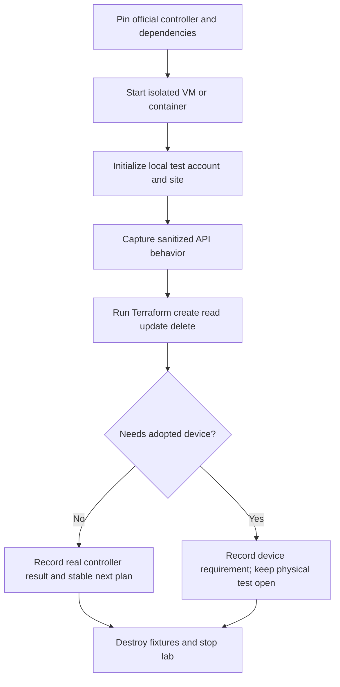

# Software-controller validation lab

Prepared for Will on 2026-10-19 after his question about virtual appliances. No real Omada controller has been run during this investigation yet. Parent: [reliability tracker](provider-reliability-prs.md).

## What is available

TP-Link distributes a free Omada Software Controller for Linux and Windows. A Linux VM can therefore host the real management application. The [official downloads](https://support.omadanetworks.com/en/download/software/omada-controller/) and [controller guide](https://support.omadanetworks.com/en/document/111217/) establish this deployment option. Linux containers may also be suitable after checking the selected version's Java, MongoDB, and service requirements; a community image must be identified as such, with its build source and digest recorded.

The previous blanket hardware-validation gate was too broad. Real controller API validation can begin without a hardware controller. Whether every configuration endpoint works with zero adopted devices must be established experimentally. Physical adoption, radio behavior, switch-port behavior, forwarding, and propagation of device credentials still require appropriate devices. TP-Link's [web emulator](https://www.tp-link.com/us/support/emulator/) demonstrates the interface; it does not establish availability of runnable device firmware or a device simulator. No official runnable switch/AP emulator was identified in this search.

The load balancer Will may have been remembering is [F5 BIG-IP Virtual Edition](https://www.f5.com/trials/big-ip-virtual-edition). That comparison motivated checking Omada's software deployment option.

## Concrete setup and review screens

| Stage | Screen / review information | Resulting action |
| --- | --- | --- |
| Select controller | Official package version, URL, checksum; VM or container dependencies | Pin an exact version matching the provider's documented target first; add newer versions separately |
| Create isolated lab | Fresh data directory, loopback management URL, synthetic local administrator; zero adopted devices | Start disposable controller; avoid production/cloud credentials and network discovery exposure |
| Initialize | Controller name, region/timezone, test site, local account; skip cloud binding and device adoption where supported | Record the setup procedure without credentials in evidence |
| Review Terraform | Local controller URL, fixture site and configuration resources; inspect plan | Run `terraform plan`, `terraform apply`, refresh, and destroy inside the existing test container |
| Inspect results | Controller version, request route/status, sanitized envelope shape, final state and next plan | Save reproducible evidence; distinguish API acceptance from physical device behavior |
| Finish | Managed test objects removed; saved evidence complete | Stop/remove disposable services and data; preserve reusable scripts and sanitized logs |

## Agenda

### 2026-10-19 — Research and scope correction

- [x] Verify official free software-controller availability and record sources.
- [x] Separate software-controller checks from physical-device checks in the reliability tracker.
- [x] Retain existing mock results as synthetic evidence; do not relabel them as controller tests.

### Next lab implementation

- [ ] Inspect the exact controller version targeted by this provider and pin an official package/checksum and compatible runtime dependencies.
- [ ] Add repeatable isolated startup, initialization, test, and cleanup scripts. Record required resources and ports before launching.
- [ ] Confirm discovery, local login, session expiry, JSON/status envelopes, and certificate operations against the real controller (A/F).
- [ ] Exercise sites/settings, networks, WLAN groups/SSIDs, credentials stored by the controller, and profile APIs where zero-device configuration is supported (D/E/G/H).
- [ ] Capture actual pagination metadata, page-size behavior, list limits, and missing-object responses for G. Never invent a not-found code mapping.
- [ ] Use measured behavior to revise mocks and implementation assumptions; rerun affected regression gates.
- [ ] Add a second controller version only after the first is reproducible. Declare exactly which versions and operations passed in PR evidence.

### Conditional — Physical-device validation

- [ ] Validate adoption and device credentials using a dedicated test device.
- [ ] Validate B/C switch-port and radio changes with supported hardware and firmware.
- [ ] Verify configuration propagation and traffic behavior separately from controller acceptance.

No lab has been installed or started by this document. This plan does not mark any real-controller gate complete.
