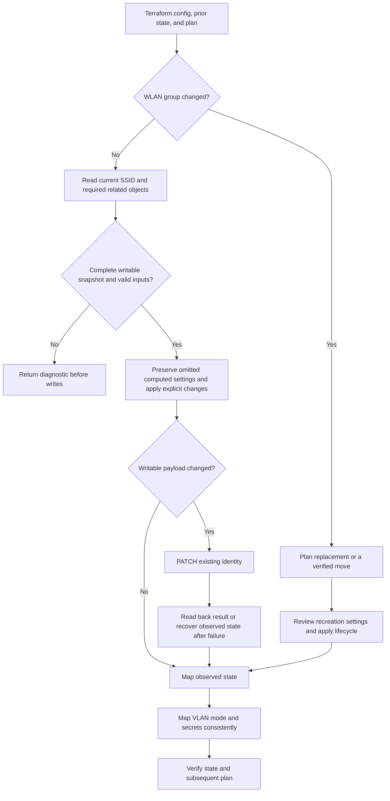

# D — SSID preservation, identity, and VLAN state

Prepared for Will on 2026-10-19. Status: D1 implemented, locally verified, committed, and pushed as [80991a5](https://github.com/wbniv/terraform-provider-tplink-omada/commit/80991a5197674a2ee5e2d93ab8d3b571ef4ea774) in `/home/will/terraform-provider-tplink-omada-ssids`, branch `fix/ssid-update-preservation`, based on `6bc71b3`; D2 and D3 remain planned. Parent: [provider reliability tracker](provider-reliability-prs.md#d--wireless-networks).

## D1 implementation status — 2026-10-19

- [x] Isolate D1 from baseline and reproduce F04 using the same maintained tests: 42 update cases and five Terraform import scenarios fail on baseline.
- [x] Implement recursive preservation, creation-only defaults, trusted password handling with migration protection, VLAN discovery guards, and authoritative readback/error state.
- [x] Pass 47 lifecycle/validation cases, eight Terraform scenarios (52 steps), formatting, vet, build, full unit suite, and A + D1 compatibility in Docker.
- [x] Update resource documentation, its generation template, example sources, and the three-part import example; record breaking omission/secret behavior and controller-version limits.
- [x] Save logs, commands, source inventory, exact versions, and tested hashes in [D1 evidence](../investigations/ssid-fix/README.md).
- [x] Commit and push D1 as [80991a5](https://github.com/wbniv/terraform-provider-tplink-omada/commit/80991a5197674a2ee5e2d93ab8d3b571ef4ea774); committed hashes match the tested files.
- [ ] Complete hardware/submission gates. No upstream PR has been opened.
- [ ] Implement D2's mode-aware VLAN state mapping next, then D3's group-change lifecycle. Their shared checklist items below remain open.

The PATCH contract remains an inference from TP-Link's v5.9 documentation and the existing v6 client model. Unknown fields/modes fail before writes. Hardware validation remains unchecked; the evidence records the PMF/version discrepancy and secret ownership decisions explicitly.

## Outcome and starting evidence

An unrelated SSID update must preserve controller settings outside that change. Terraform must also report the correct WLAN-group identity and clear a custom VLAN from state when the controller returns default VLAN mode.

| Finding | Confirmed baseline behavior | Required outcome |
| --- | --- | --- |
| [F04](../investigations/2026-10-18-code-review.md#f04--ssid-updates-reset-unmodeled-controller-settings) | Update constructs creation defaults, disabling guest/filter/schedule controls and replacing rate, multicast, and PSK settings. | Build updates from current writable settings plus deliberate configuration changes. |
| [F13](../investigations/2026-10-18-code-review.md#f13--changing-an-ssids-wlan-group-cannot-work-as-planned) | Update uses the prior WLAN-group path and returns the prior group despite a planned change. | A supported move or an explicit Terraform replacement plan; no successful apply that ignores the new group. |
| [F14](../investigations/2026-10-18-code-review.md#f14--ssid-refresh-retains-a-custom-vlan-that-no-longer-exists) | Read retains an old VLAN when the controller returns mode 0. | Default VLAN mode maps to null `vlan_id`; stale custom fields cannot override the mode. |

Baseline: `6bc71b310bc81a90f3ad32194ba8c17947bf79d6`. Retained [resource probes](../investigations/reproductions/resources_probe_test.go.txt) and [failure log](../investigations/evidence/behavior-probes.log) cover all three findings. Start from `TestInvestigationWirelessUpdateResetsSettings`, `TestInvestigationWirelessGroupChange`, and `TestInvestigationWirelessVLANRefresh`. These are direct lifecycle probes; add actual Terraform planning/apply coverage.

Code to inspect: [resource lifecycle/schema](https://github.com/emanuelbesliu/terraform-provider-tplink-omada/blob/6bc71b310bc81a90f3ad32194ba8c17947bf79d6/internal/resources/wireless_network.go), [client models and SSID operations](https://github.com/emanuelbesliu/terraform-provider-tplink-omada/blob/6bc71b310bc81a90f3ad32194ba8c17947bf79d6/internal/client/client.go), and [resource documentation](../resources/wireless_network.md).

## Patch boundaries

| Order | Proposed branch | Scope | Base and dependency |
| --- | --- | --- | --- |
| D1 | `fix/ssid-update-preservation` | F04: preservation, defaults, secret handling, update/readback regressions, migration notes. | Baseline; check compatibility with authentication A (`52ed681`). |
| D2 | `fix/ssid-vlan-state` | F14: mode-aware VLAN state mapping shared by Read/Import and relevant write readback. | Baseline when independent; record any deliberate dependency on D1. |
| D3 | `fix/ssid-group-identity` | F13: group-change planning and lifecycle, import identity, migration/downtime note. | Prefer an independent patch; if replacement needs D1's create/default fixes, record and test that stack. |

Suggested titles: `fix(resources): preserve SSID settings during updates`, `fix(resources): clear stale SSID VLAN state`, and `fix!: require replacement for SSID WLAN group changes` if replacement is selected. Use a breaking-change title/footer for D1 if omission/default semantics change.

- [x] Create D1 from the recorded baseline; retain A–C and the documentation branch separately.
- [ ] Create D2 and D3 worktrees from their chosen bases.
- [ ] Recheck upstream heads and contribution requirements before starting and before submission.
- [x] Keep new controller evidence and patch logs under `docs/investigations/ssid-fix/`; preserve original reproductions and logs.

## Decisions before payload implementation

### Writable fields and controller requirements

- [x] Record the conservative PATCH contract from the official reference and existing client; see D1 evidence.
- [ ] Verify that contract on the target controller/firmware. The full-object requirement remains an inference until captured traffic or hardware confirms it.
- [x] Inventory writable fields recursively, including guest controls, filters and their lists, schedules, rate limits, multicast, PSK version/encryption/rekey settings, MLO, and Wi-Fi sharing controls. Record each field's source, omission meaning, and supported controller versions.
- [x] Use `GetWirelessNetworkRaw` or a narrowly extended reader to retain unmodeled settings. It currently accepts a paginated envelope and reads only the first 100 SSIDs; test direct-array responses if supported and keep lookup failures explicit. Full collection pagination remains work G.
- [x] Construct a fresh payload with an explicit writable-field allowlist, including nested fields. Exclude IDs/status/capability fields; the current client's small removal list alone is insufficient.
- [x] Preserve absent versus explicit false/zero/empty values. Reject incomplete required snapshots or failed discovery before PATCH. Do not serialize zero-filled structs for unknown values.
- [x] If controller evidence is unavailable, record the assumed payload contract, complete mock verification, and leave hardware compatibility unchecked. Do not describe mock acceptance as API compatibility proof.

### Configuration ownership and defaults

The current schema defaults `band=3`, `security=3`, `broadcast=true`, `enable_11r=false`, and `pmf_mode=2`. These can turn omission into a change during import, even after the payload builder is corrected.

- [x] Preserve omitted Optional+Computed settings on existing SSIDs. Choose and test how creation defaults are supplied in the plan without overwriting imported values; retain intended create behavior or explicitly document its change.
- [x] Keep explicit configured values authoritative, including false and valid zero values. Test unknown plan values through Terraform and distinguish them from removal of configuration.
- [x] Keep the current `vlan_id` contract explicit: it is Optional, with omission selecting default VLAN. Preserve a configured custom VLAN during a rename; removal should deliberately select mode 0. Changing this to preserve an omitted custom VLAN would require a separate schema/ownership decision and migration note.
- [x] Audit creation and update together when defaults change: the resulting state must match known planned values, and a repeated plan must settle.

### Secrets and security changes

- [x] Preserve PSK mode, encryption, and rekey controls during rename and password-only rotation. Do not force `versionPsk=2` and `encryptionPsk=3` during an unrelated update.
- [x] Test plaintext, absent, and controller-specific masked responses. Never send a mask as a password or replace a known configured secret in state with a mask. Establish actual masking conventions before interpreting returned strings.
- [x] Define removal of `passphrase` configuration separately from a transition to open security. An omitted secret must not silently clear the remote password; state handling must respect the attribute's Optional/Sensitive contract.
- [x] If a full PATCH requires a secret that cannot be recovered, fail before mutation with an actionable diagnostic, or use verified omission semantics. Do not invent a secret or log it.
- [x] Validate open-to-secured and secured-to-open transitions before writes, including required passphrase and PMF/PSK fields. Keep fixture passwords synthetic.

### WLAN-group identity

The current client exposes create/read/update/delete within a group and no move operation. The proposed default is to require replacement when a known configured `wlan_group_id` changes. Adopt an in-place move only after identifying and verifying a supported controller operation, including the resulting ID and readback path.

- [ ] Test replacement planning, unchanged/omitted/unknown group values, and the existing `UseStateForUnknown` behavior. Omission after import must not silently switch to a different group.
- [ ] If replacement is selected, verify destruction uses the old group and creation uses the new group; verify the new ID and a stable follow-up plan. Review create-before-destroy behavior and duplicate-name handling explicitly.
- [ ] Document possible connectivity interruption and the loss of unmanaged settings during recreation. Specify what configuration must be supplied to recreate the desired SSID; preserving unmanaged settings during ordinary updates does not promise preservation across replacement.
- [ ] Preserve `site_id` replacement semantics and the three-part import ID `siteID/wlanGroupID/ssidID`. Fix the current documentation/example that omits the site component.

## Review screens and resulting actions

These are illustrative acceptance targets for the existing Terraform CLI and test evidence. They show intended effects, not captured output or guaranteed wording. Fixture names and values are synthetic.

### 1. Import and rename review

| Review screen: `terraform plan` after import | Expected display/effect |
| --- | --- |
| Resource | `omada_wireless_network.test` in `site/group/ssid` |
| Configured change | `name: "Guest" → "Guest-Renamed"` |
| Controller settings to preserve | Guest enabled; filter/schedule enabled; nondefault rate limits and PSK mode; configured VLAN 20 |
| Review choice | Apply the reviewed plan, or revise configuration. |
| Resulting action | Read current settings; PATCH the same SSID in the same group with the deliberate change and required preserved fields. |
| Verification screen | Readback retains protected settings; repeated `terraform plan` shows no changes. |

### 2. Group-change review

| Review screen: `terraform plan` | Expected display/effect if replacement is selected |
| --- | --- |
| Configured change | `wlan_group_id: "group-a" → "group-b"` |
| Planned action | Replace the SSID; the plan visibly distinguishes destruction and creation. |
| Review choice | Review recreation settings and interruption before applying. |
| Resulting action | Delete using the old identity and create in the new group, in Terraform's selected lifecycle order. |
| Verification screen | State records the new group and controller-returned ID; subsequent plan is empty. |

### 3. Remote VLAN drift review

| Review screen: refresh-only plan/state inspection | Expected display/effect |
| --- | --- |
| Controller change | Custom VLAN 20 → mode 0, with any stale custom fields ignored. |
| Observed state change | `vlan_id: 20 → null` |
| Resulting action | Read only; no PATCH during refresh. |
| Next normal plan | Proposes restoring 20 if it remains configured; settles when default VLAN is configured. |

## Update flow

## Regression matrix

| Area | Cases | Required assertions |
| --- | --- | --- |
| Import/rename | Default and nondefault modeled values; enabled guest/filter/schedule; nested rate/multicast settings | Capture outgoing body and remote state; all untouched writable values preserved. |
| Explicit updates | Name, band, broadcast, roaming, PMF, valid false/zero, partial nested changes | Exactly intended values change; unknown/null semantics match the documented ownership contract. |
| Secrets | Plaintext/masked/absent key, password rotation, omitted config, security transitions | No masks sent; no real secrets in evidence; planned and returned state agree. |
| VLAN state | Mode 0 with stale custom data; custom mode; missing setting; `currentVlanId` fallback | Mode governs interpretation; default clears state; unsupported/malformed modes handled deliberately. |
| VLAN updates | Preserve configured VLAN, change VLAN, remove VLAN, failed/missing network lookup | Correct network association or explicit failure before mutation; no guessed IDs. |
| Group identity | Same, omitted, unknown, changed group; import; replacement failure | Correct plan action, old/new request paths, ID, state, and retry behavior. |
| Response handling | Full and empty success bodies; injected read/PATCH/readback failures | Preserve trustworthy state; do not report an unapplied plan as success. |
| Collection limits | Direct array/envelope as supported; target outside the current first-page lookup | Failure stays visible and causes no mutation; pagination fix remains G. |
| Stability | Repeated plans, removal of configured computed fields, remote drift | No perpetual diffs or inconsistent-result errors. |

- [x] Promote F04 into maintained lifecycle and Terraform tests and capture failure on the recorded base.
- [ ] Promote F13/F14 probes for D3/D2.
- [x] Add real Terraform mock acceptance for D1 import/rename, creation, explicit changes, unknown values, secret handling, VLAN writes, and repeated plans.
- [ ] Add group planning/lifecycle and VLAN drift acceptance under D3/D2.
- [x] Assert the allowlist excludes read-only fields and that all validation precedes writes. Separate expected fixture failures from actual passing patch validation.

## Verification and PR package

Use Go `1.25.6` in `golang:1.25.6@sha256:06d1251c59a75761ce4ebc8b299030576233d7437c886a68b43464bad62d4bb1`, matching the recorded repository pin. Use the already validated Terraform `1.15.8` executable for comparable mock runs. Recheck pins if the implementation base changes.

| Gate | Command or evidence |
| --- | --- |
| Formatting | `gofmt -l .`; Terraform example formatting where changed |
| Static/build | `go vet ./...`; `go build ./...` |
| Unit suite | `go test ./... -count=1 -cover` |
| Planned maintained regression names | `TestWirelessNetworkPreservation`, `TestWirelessNetworkVLANState`, `TestWirelessNetworkGroupIdentity` |
| Planned Terraform acceptance | `TF_ACC=1 TF_ACC_TERRAFORM_PATH=/usr/local/bin/terraform go test ./internal/provider -run TestAccWirelessNetwork -count=1 -v -timeout=180s` |
| Compatibility | Test the applicable D patch(es) with A's committed client changes in a disposable checkout; record the exact combination. |
| Hardware | Controller version, model/firmware, sanitized writable payloads, before/after settings, and observed readback. |

- [x] Preserve baseline/patch logs, exact base/head revisions, file hashes, image digest, tool versions, and commands in the evidence README.
- [x] Review schema/state compatibility, create behavior, import IDs, release classification, and any removed defaults. Update resource docs and their example sources together.
- [x] Run relevant container checks before committing; avoid unrelated dependency/workflow changes. Add race checks only if shared concurrency behavior changes or an existing gate requires them.
- [ ] Keep HTTP envelope classification, full pagination, default-group discovery, and missing-resource semantics tracked under their existing work items. Add any newly reproduced defect to the tracker with evidence.
- [ ] Leave real-controller validation unchecked until performed. The current CI runs client/resource tests; mock provider acceptance still needs a separate recorded run until CI is expanded.
- [ ] Recheck contribution and AI-attribution requirements at submission. Include verified tool/model/reasoning metadata if attribution is required or expected; never guess it.
- [ ] Prepare conventional commits and separate PR descriptions with cause, change, failing/passing evidence, migration instructions, and limitations. Record fork push, upstream PR URL, CI, reviews, and merge separately.
- [ ] Update this plan, the parent tracker, and the investigation status as work proceeds; remove temporary containers and disposable checkouts after recording evidence.

## Agenda and completion

### 2026-10-19 — Planning

- [x] Inspect the current SSID schema, lifecycle, client models, retained probes, and documentation.
- [x] Record three patch boundaries, decision gates, review screens, flow, tests, and submission requirements.

### 2026-10-19 — D1 implementation

D1 is complete locally and committed/pushed to Will's fork; hardware testing and upstream publication remain separate gates.

- [x] Begin D1 with the retained F04 reproduction and a maintained import-and-rename acceptance case.
- [x] Resolve default/secret ownership and the writable payload contract; implement and verify D1.

### Undated — Remaining implementation
- [ ] Implement and verify D2's mode-aware VLAN mapping.
- [ ] Resolve the group-change mechanism and implement/verify D3.

### Conditional — Controller access and upstream review

- [ ] Validate accepted payloads and lifecycle behavior on controlled hardware when available.
- [ ] Submit reviewable PRs when authorized and record reviewer/CI follow-ups.

Done locally means all three findings have a defined implementation, failing baseline/passing patch regressions, stable Terraform plans, reviewed migration behavior, and recorded evidence. Submitted and merged are separate states; hardware compatibility remains explicitly unverified until tested.
